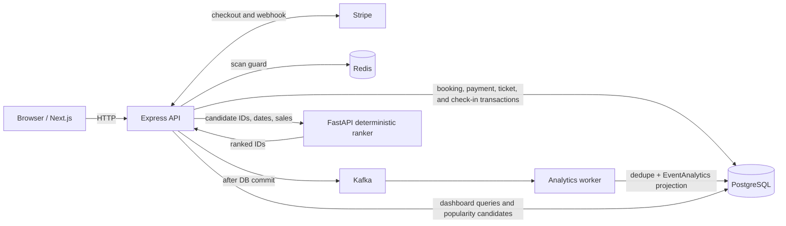

# Event Ticketing

A multi-tenant event ticketing MVP with organizer and staff access, Stripe Checkout, QR tickets and check-in, plus asynchronous analytics projections and a public popularity list.

## Features

- Organizer-scoped event and ticket-tier management, bookings, payment reconciliation, and staff ticket check-in.
- Next.js client and Express/Prisma API backed by PostgreSQL, with Redis, Kafka, an analytics worker, and a FastAPI popularity ranker.
- Docker Compose local stack and GitHub Actions image build and VPS deployment workflows.

## Architecture and data flow



The diagram distinguishes the PostgreSQL transaction path from asynchronous analytics and popularity ranking.

## Engineering decisions and trade-offs

- Stripe webhooks, rather than browser redirects, confirm payment. Ticket creation and booking/payment state changes are transactional and webhook processing is idempotent.
- Kafka publication happens after the PostgreSQL commit. There is no transactional outbox, so a failed or uncertain publish can leave analytics stale or incomplete. Analytics is eventually consistent; duplicate deliveries are protected by `ProcessedDomainEvent`.
- Check-in uses a Redis `SET NX` guard and a PostgreSQL transaction/unique check-in constraint. Redis is required for the check-in request path; PostgreSQL is the durable authority. Without a connected Redis, refresh-token and revocation state falls back to process memory, so it is not durable across restarts.
- Public popularity uses recorded all-time ticket sales and stable tie-breaks. It is neither personalized nor a time-windowed trending score.
- The single-node Compose Kafka/PostgreSQL/Redis setup and simple VPS workflow favor an understandable MVP over high availability or production-grade recovery guarantees.

## Local development

Prerequisites: Docker Compose, Node.js 20+, and npm. From the repository root, copy the environment examples:

```powershell
Copy-Item .env.example .env
Copy-Item api/.env.example api/.env
Copy-Item client/.env.example client/.env
```

Set `POSTGRES_PASSWORD` in the root `.env`. Set its Compose-network database URLs to `postgresql://postgres:<password>@postgres:5432/event_ticketing` for both `DATABASE_URL` and `DIRECT_URL`. In `api/.env`, set both URLs to `postgresql://postgres:<password>@localhost:5433/event_ticketing` for host-run API and Prisma commands. Keep the password consistent. The root `.env.example` supplies the local service ports and client defaults; real `.env` files must not be committed.

Start dependencies, apply migrations, seed the local database, then run the API and client in separate terminals:

```powershell
docker compose up -d postgres redis kafka recommendation-service
Set-Location api
npm ci
npm run prisma:migrate
npm run seed
npm run dev
```

```powershell
Set-Location client
npm ci
npm run dev
```

Open `http://localhost:3000`; the API is at `http://localhost:4000`. `npm run prisma:migrate` is for local development. Production uses `prisma migrate deploy`. Stripe checkout/webhook flows require Stripe test credentials and local webhook forwarding. The API test script is present, but this checkout has no `api/tests` files; the client package has no test script.

To run the complete container stack instead of host-run API/client processes, first apply migrations and seed from the host using the API steps above, stop any host-run API/client processes, then run `docker compose up -d --build`. Compose does not apply migrations or seed data, and the API image does not include the Prisma CLI. See [API setup](api/README.md) for service commands and [deployment notes](docs/deployment.md) for the VPS workflow.

## Verification and limitations

The repository includes API build/typecheck scripts, client build/lint/typecheck scripts, and API unit-test command configuration. CI workflows build and publish three images; the deploy workflow is configured to wait for all three, run production migrations, start Compose, and check API health. The production API image removes the Prisma CLI even though the deploy workflow invokes it there, so that migration step is not self-contained or verified. CI configuration and health checks do not establish production readiness. This README describes repository configuration; run the documented commands in your environment to verify local services and external integrations.

Payment provider behavior, production secrets, deployment credentials, external networking, backup/restore, and operational recovery require environment-specific validation.

## Documentation

- [Repository constraints](docs/project-context.md)
- [Feature implementation guide](docs/feature-implementation-guide.md)
- [API commands and Swagger docs](api/README.md)
- [Client setup](client/README.md)
- [VPS deployment](docs/deployment.md)
